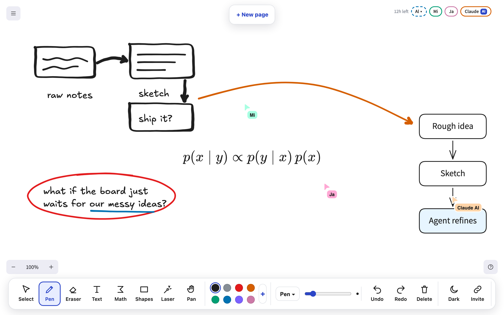
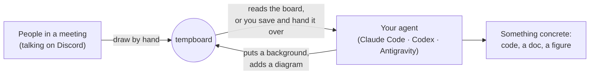
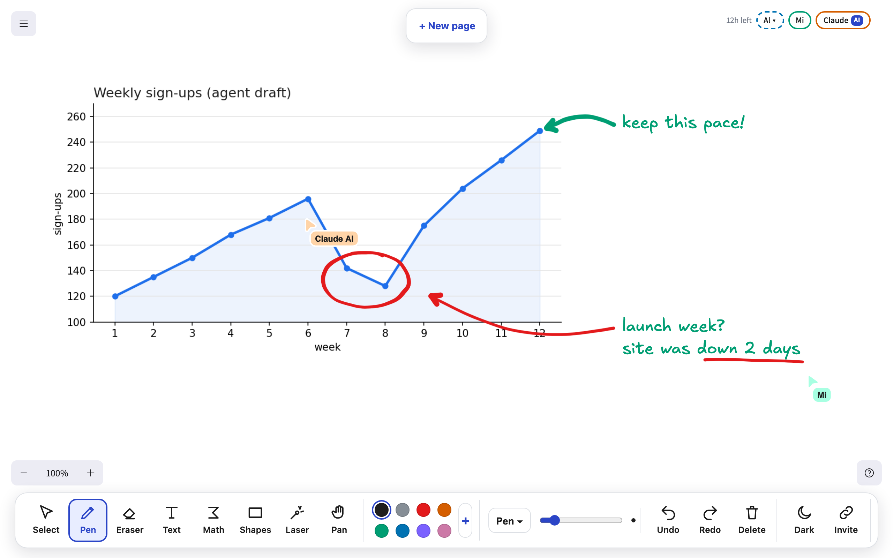
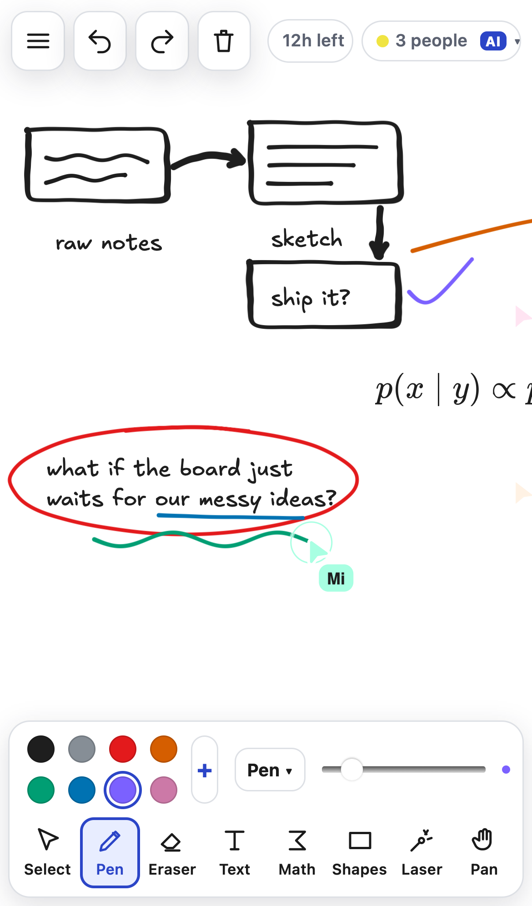

# tempboard

**Just draw.** A shared whiteboard for rough thinking — with people in a meeting, or with your AI agent.



Don't write it all out. Sketch the idea, circle it, draw an arrow, talk it over.
Making it concrete comes later — that's what your agent is for.

## What it's for

- **Meetings.** Open a board, drop the link into Discord, and sketch together while you talk. Everyone draws live; no accounts.
- **Working with an agent.** Ask Claude Code, Codex or Antigravity to put a background on the board (a diagram, axes, a picture) and draw over it by hand. When you're done, the agent reads the board — or you save the drawing and hand it over — and turns the rough idea into something real.
- **Text and math too.** Type a note, or write a formula in LaTeX ($p(x\mid y) \propto p(y\mid x)\,p(x)$).





## Get started

Install it into your agent:

```
# Claude Code
/plugin marketplace add Joonoh991119/tempboard
/plugin install tempboard@tempboard

# Codex
codex plugin marketplace add Joonoh991119/tempboard
codex plugin add tempboard@tempboard

# Antigravity
agy plugin install https://github.com/Joonoh991119/tempboard
```

Then just ask:

> "Open a whiteboard and give me the link."
> "Put a 2×2 grid on the board so we can sort these ideas."
> "Read what we drew and turn it into a plan."

You get an invite link (draw together) and, if you want, a view-only link. The board closes itself after 12 hours; your drawings stay on your computer.



Works on phones and tablets too. Korean and English (switch from the menu).

## Good to know

- Needs Python 3.9+, and [`cloudflared`](https://developers.cloudflare.com/cloudflare-one/connections/connect-networks/downloads/) for links that work outside your computer (`brew install cloudflared`).
- Anyone with the invite link can draw. Share it with the people you mean to.
- Want an always-on board on your own domain, agent tokens, importing files, or the full CLI? See the **[guide](docs/guide.md)**.

## License

MIT — see [LICENSE](LICENSE). Built on [Excalidraw](https://github.com/excalidraw/excalidraw) (MIT); third-party notices in [THIRD_PARTY_NOTICES.md](THIRD_PARTY_NOTICES.md).
